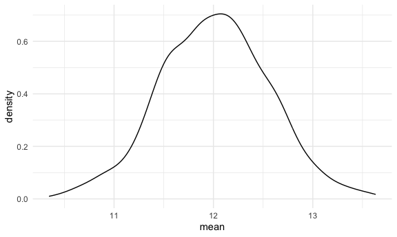
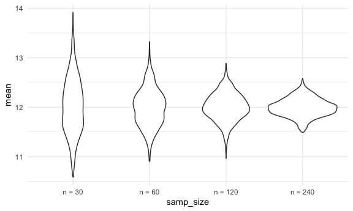
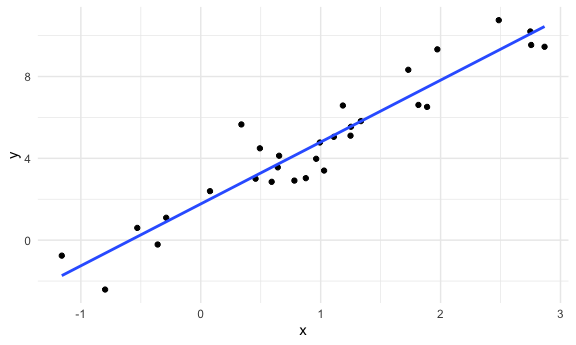
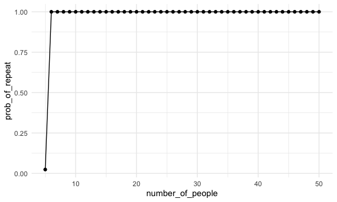

03_simulation
================
Yuyao
2026-11-10

``` r
library(tidyverse)

source("sim_mean_sd.R")

set.seed(1236)
```

``` r
output = vector("list", length = 1000)

for (i in 1:1000) {
  
  output[[i]] 
}
```

let’s do this using tibbles and map instead!

``` r
sim_results_df =
  tibble(
    samp_size = rep(30, 1000)
  ) |> 
  mutate(
    est_df = map(samp_size, sim_mean_sd)
  ) |> 
  unnest(est_df)
```

look at results

``` r
sim_results_df |> 
  ggplot(aes(x = mean)) + 
  geom_density()
```



## change `n`

``` r
sim_results_df =
  expand_grid(
    samp_size = c(30, 60, 120, 240),
    iter = 1:1000
  ) |> 
  mutate(
    est_df = map(samp_size, sim_mean_sd)
  ) |> 
  unnest(est_df)
```

``` r
sim_results_df |> 
  mutate(
    samp_size = str_c("n = ", samp_size),
    samp_size = fct_inorder(samp_size)
  ) |> 
  ggplot(aes(x = samp_size, y = mean)) +
  geom_violin()
```



look at the numbers

``` r
sim_results_df |> 
  mutate(
    samp_size = str_c("n = ", samp_size),
    samp_size = fct_inorder(samp_size)
  ) |> 
  group_by(samp_size) |> 
  summarise(
    emp_m = mean(mean),
    emp_se = sd(mean)
  )
```

    ## # A tibble: 4 × 3
    ##   samp_size emp_m emp_se
    ##   <fct>     <dbl>  <dbl>
    ## 1 n = 30     12.0  0.563
    ## 2 n = 60     12.0  0.382
    ## 3 n = 120    12.0  0.279
    ## 4 n = 240    12.0  0.185

## SLR

generate once

``` r
sim_data = tibble(
  x = rnorm(30, mean = 1, sd = 1),
  y = 2 + 3 * x + rnorm(30, mean = 0, sd = 1)
)

sim_data |> 
  ggplot(aes(x = x, y = y)) +
  geom_point() + 
  geom_smooth(method = "lm", se = FALSE)
```

    ## `geom_smooth()` using formula = 'y ~ x'



turn this into a function -\> `sim_slr.R`

``` r
source("sim_slr.R")

sim_slr(30)
```

    ## # A tibble: 1 × 2
    ##   beta0_hat beta1_hat
    ##       <dbl>     <dbl>
    ## 1      2.00      2.78

do this a lot

``` r
slr_results_df = 
  tibble(
    samp_size = rep(30, 1000)
  ) |> 
  mutate(
    est_df = map(samp_size, sim_slr)
  ) |> 
  unnest(est_df)
```

is this right?

``` r
# slr_results_df = 
#   summarise(
#     b0_mean = mean(beta0_hat),
#     b0_se = sd(beta0_hat)
#   )
```

## Birthday problem

``` r
source("birthday_repeated.R")

birthday = sample(1:365, size = 5, replace = TRUE)

repeated_birthdays = length(unique(birthday)) < 5 
```

turn this into a function -\> `birthday_repeated.R`

``` r
birthday_repeated(5)
```

    ## [1] FALSE

run it a bunch but good

``` r
birthday_results_df = 
  expand_grid(
    number_of_people = 5:50,
    iter = 1:1000
  ) |> 
  mutate(
    repeated = map_lgl(number_of_people, birthday_repeated)
  )

birthday_results_df |> 
  group_by(number_of_people) |> 
  summarise(prob_of_repeat = mean(repeated)) |> 
  ggplot(aes(x = number_of_people, y = prob_of_repeat)) + 
  geom_point() + 
  geom_line()
```


